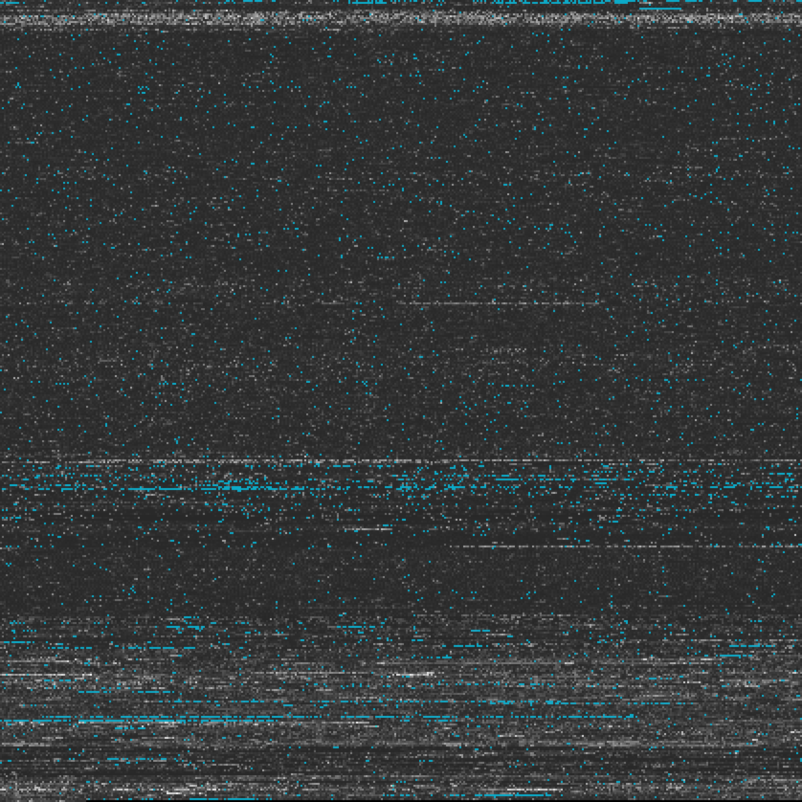

<p align="center"></p>

# 175,187

That's not noise up there.

Two days ago a proof of the Riemann hypothesis showed up: written by a machine, checked by
a machine, a quarter of a million pages of it. A gigabyte of Lean nobody will ever read.

We didn't read it either.

We looked at it.

Every square in that picture is one file of the proof. Every one of them is real, and every
one of them still answers to the original, byte for byte. Brighter means more of the proof
is standing on it. The blue ones repeat themselves. There are no red ones.

There was supposed to be red.

---

### What we found

| | |
|---|---|
| files | **175,187** |
| lines | **17,374,215** |
| declarations | **1,066,087** |
| `sorry` · `admit` · homemade `axiom` · `native_decide` · `unsafe` | **0 · 0 · 0 · 0 · 0** |
| bodies that are exact copies of another | **~3%** |
| files nothing depends on | **1**, the theorem itself |
| the stone everything rests on | `RhoDetPrimeEqMuTildeMulChiPow` |

It has changed twice since it was released. This is the first one.

---

### The picture is not just a picture

`RIEMANN_PROOF_IN_PIXELS.lcarspic.png` (in **Releases**) opens as an image anywhere.

Open it another way and it remembers what it is: the whole map. Every file's name, its
fingerprint, what it leans on, what leans on it. Ask it for any piece and that piece comes
home from where it lives, and proves it's the same one that left.

58 MB of picture. One gigabyte of proof. None of the proof is actually in it.

Don't believe us. Check:

```bash
file RIEMANN_PROOF_IN_PIXELS.lcarspic.png
unzip -l RIEMANN_PROOF_IN_PIXELS.lcarspic.png
```

```bash
unzip -p RIEMANN_PROOF_IN_PIXELS.lcarspic.png atoms.jsonl.gz | gunzip | grep -m1 '"lean/src/Main.lean"'
```

```bash
curl -s https://raw.githubusercontent.com/leanprover-community/riemann-hypothesis/40e56bab026552e089d7afcfeff08d2defb9c005/src/Main.lean | shasum -a 256
```

The last two print the same fingerprint, `017645ca…0939`. Pick any other file and do the
same. We did it with eight at random. Eight for eight.

```
picture  sha256  910e018e2877fcdf68807592d6e64fcefcde624f6a462e4cea32892cfa469c9e
```

---

### What this is not

- Not our proof. It belongs to the people and the machine who made it:
  [the official release](https://alpo.ge) · [the mirror](https://github.com/leanprover-community/riemann-hypothesis).
- Not a verdict on whether it's right. MIT's [independent check](https://math.mit.edu/~drew/grh/)
  is the one that compiled it. We counted, we mapped, and we kept the receipts.
- Not a copy. The map holds names, fingerprints and wiring. The words stay where they live.

---

### Why we did it

Because a file should know what it is, and tell you where the rest of it went.

That's the whole idea behind what we build. This was a fun night.

**Onyx Box** · [onyxsafebox.com](https://onyxsafebox.com) · [App Store](https://apps.apple.com/us/app/onyx-box/id6798628929)

— Ezri, for BellTone Labs
